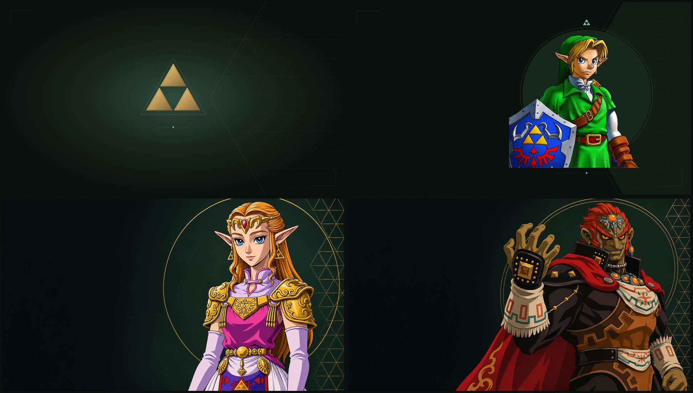

# The Legend of Zelda — 40th Anniversary

An unofficial Omarchy fan theme celebrating Hyrule: charcoal surfaces, vibrant emerald accents, antique gold, character wallpapers, and an optional animated Triforce + Navi screensaver.



## Install

Requires Omarchy with `colors.toml` theme support.

```bash
omarchy theme install https://github.com/caicruzz/the-legend-of-zelda-40th-anniversary.git
```

Already installed? Apply it with:

```bash
omarchy theme set the-legend-of-zelda-40th-anniversary
```

Cycle the four wallpapers from Omarchy's background picker or run:

```bash
omarchy theme bg next
```

The palette uses emerald `#229954`, charcoal `#171d1b`, parchment `#e5ddc6`, and antique gold `#d8b66a`. Omarchy generates the supported terminal, editor, and shell colors from `colors.toml`.

## Wallpapers

- **Sacred Realm:** a geometric gold Triforce; 3840 × 2160.
- **Link:** original Ocarina of Time character artwork in the matching geometric frame; 3840 × 2160.
- **Zelda:** a detailed cel-shaded portrait inspired by her Ocarina of Time artwork; 1672 × 941.
- **Ganondorf:** a detailed cel-shaded portrait inspired by his Ocarina of Time artwork; 1672 × 941.

Zelda and Ganondorf were created with AI using character references. See [artwork credits](THIRD_PARTY.md).

## Optional Triforce + Navi screensaver

A glowing Triforce, drifting gold sparks, and Navi circling with fluttering wings and a blue sparkle trail. Requires the Omarchy Quickshell idle plugin system, Python 3, and a supported true-color terminal: Foot, Alacritty, Ghostty, or Kitty.

Preview after installing the theme:

```bash
~/.config/omarchy/themes/the-legend-of-zelda-40th-anniversary/screensaver/launch force
```

To use it automatically when idle:

```bash
python3 ~/.config/omarchy/themes/the-legend-of-zelda-40th-anniversary/screensaver/setup.py
```

Setup clones Omarchy's idle service into your user configuration when necessary, backs up its original service, and connects this theme's launcher. It preserves your idle and lock timeouts. Switching to another theme uses Omarchy's standard screensaver. Press any key or move the mouse to dismiss.

If you already have a custom idle launcher, setup stops without replacing it. The preview command remains available. Setup does not change the System → Screensaver menu.

Restore the standard idle screensaver before removing the theme:

```bash
python3 ~/.config/omarchy/themes/the-legend-of-zelda-40th-anniversary/screensaver/setup.py --uninstall
```

## Credits

Made by [Cai Cruz](https://github.com/caicruzz). Theme configuration and original code are MIT licensed; Nintendo character artwork and franchise assets are excluded. This is an unofficial fan project and is not affiliated with Nintendo. [Licensing and source credits](THIRD_PARTY.md).
